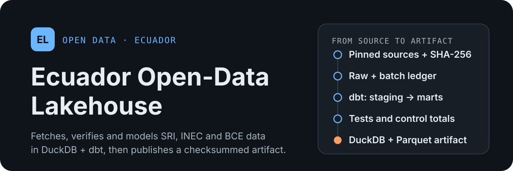
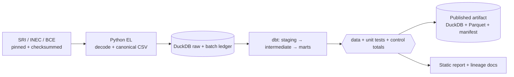

<p align="center"></p>

<p align="center"><a href="README.md">Español</a> · <b>English</b></p>

Fetches Ecuadorian open data from SRI, INEC and BCE, verifies its checksums, models it with dbt and publishes a versioned artifact, all on the local machine.

[](https://github.com/Eduardo12Pacheco/lakehouse-datos-abiertos-ecuador/actions/workflows/ci.yml) [](https://github.com/Eduardo12Pacheco/lakehouse-datos-abiertos-ecuador/releases/latest) [](LICENSE) [](pyproject.toml)


| Light theme | Dark theme |
| --- | --- |
|  |  |

## What it is

A local-first analytics-engineering lakehouse over verified Ecuadorian open data: SRI tax collection, INEC consumer prices and BCE national accounts. It models a star schema in DuckDB with dbt and serves an offline static report.

## Why it is different

- **Pinned, verifiable sources.** Each file has a pinned URL, a SHA-256 checksum, license evidence and a host allow-list. The default build uses the bundled sample and needs no network.
- **Handles messy public files.** SRI CSVs with UTF-8 BOM and cp1252, `|` delimiters and comma decimals; BCE semicolons and thousands separators; nested INEC zips with Spanish month headers.
- **Conformed star schema in dbt.** 7 dimensions, 3 facts and 4 analytic marts, a deterministic SCD2 tax-line dimension and partition-level incremental fact loads.
- **Quality as a gate.** dbt data and unit tests, reconciliation to control totals and Hypothesis property tests. If a test fails, the pipeline stops with exit code 7.
- **Versioned, verifiable artifact.** DuckDB + ZSTD Parquet + manifest + `SHA256SUMS`, checked by `lakehouse verify` and guarded by a semver contract.
- **Static report, served locally.** Loopback server with light and dark themes, keyboard navigation, empty and error states, and vendored ECharts (no CDN).

## How it works



Hexagonal ports and adapters keep the domain pure: Python owns extraction and dbt owns every transformation. Import-linter contracts and an AST test enforce the dependency direction. Layers, ports, patterns, the ER diagram, the pipeline DAG and exit codes are in [docs/ARCHITECTURE.md](docs/ARCHITECTURE.md).

## Quickstart

Requires [uv](https://docs.astral.sh/uv/), which installs Python 3.12 if needed. These commands are identical in bash, zsh and Windows PowerShell:

```bash
uv tool install git+https://github.com/Eduardo12Pacheco/lakehouse-datos-abiertos-ecuador
lakehouse build
lakehouse serve
```

The report opens at `http://127.0.0.1:15080` (override with `--port` or `LAKEHOUSE_SERVE_PORT`). `lakehouse build` uses only the bundled sample and needs no network, keys or accounts. CI installs the wheel and runs `lakehouse doctor` and `lakehouse build` offline on Ubuntu, Windows and macOS.

<details>
<summary>Install from a release wheel</summary>

Every tagged release attaches the wheel and sdist:

```bash
uv tool install https://github.com/Eduardo12Pacheco/lakehouse-datos-abiertos-ecuador/releases/download/v0.1.1/ecuador_open_data_lakehouse-0.1.1-py3-none-any.whl
```

</details>

## Results

A fresh `sample` build on the bundled data. Regenerate this table and the snapshot in [`docs/METRICS.json`](docs/METRICS.json) with `uv run python scripts/gen_metrics.py`; a test fails if the READMEs drift.

<!-- metrics:start -->
| Metric | Value |
| --- | ---: |
| dbt models | 22 |
| dbt data tests | 254 |
| dbt unit tests | 11 |
| pytest tests (default suite) | 688 |
| browser e2e tests | 51 |
| bundled sample payload files | 12 |
| bundled sample size (bytes) | 4,150,137 |
| rows in raw | 1,185,307 |
| rows in staging models | 1,185,307 |
| rows in intermediate models | 4,726 |
| rows in marts | 1,184,086 |
| tables in the published artifact | 14 |
<!-- metrics:end -->

The published artifact keeps only `marts` and `meta.build_info`: 7 dimensions, 3 facts and 4 analytic marts. Two fresh builds produce identical `content_sha256` values for every table.

## Limitations

**Status:** active portfolio project. Package `0.1.1`; the artifact contract is at `1.0.0` and follows semver ([contract](docs/CONTRACT.md)).

- SRI collection covers **SRI-administered taxes only**; it is not total fiscal pressure or the whole public budget.
- The CPI vintage stops at **Dec-2024** (base 2014 = 100); the 2026 rebase is out of scope.
- BCE national accounts stop at **2021Q1**, so the SRI/GDP ratio is only complete for 2017–2020 and partial later years are flagged `is_complete = false`.
- The bundled sample is **province grain**; `full` mode keeps cantons. The SCD2 lifecycle is real, but no group/subgroup reclassification occurs in 2017–2026.
- The SRI current-year file is mutable upstream; its checksum is accepted as a new vintage only with an explicit flag.

## Documentation

- [Architecture](docs/ARCHITECTURE.md) · [Data](docs/DATA.md) · [Artifact](docs/ARTIFACT.md)
- [Contract](docs/CONTRACT.md) · [Configuration](docs/CONFIGURATION.md) · [Lineage](docs/LINEAGE.md)
- [ADRs](docs/adr/) · [Contributing](CONTRIBUTING.md) · [Security](SECURITY.md) · [Changelog](CHANGELOG.md)

<details>
<summary>Development</summary>

```bash
uv sync --locked
uv run python scripts/dev.py check
uv run pytest -m e2e
```

`scripts/dev.py check` runs ruff lint/format, mypy strict, import-linter and the pytest suite with the 85 % branch-coverage gate. Browser tests live behind `-m e2e`; `lakehouse doctor` checks versions, the home directory and the bundled sample integrity.

</details>

## License

Code is MIT licensed. Data keeps its source license and is redistributed only where the license allows it; [`ATTRIBUTION.md`](src/ecuador_lakehouse/sample_data/ATTRIBUTION.md) records URLs, checksums and modifications. Full provenance and measured facts are in [docs/DATA.md](docs/DATA.md).

| Source | Coverage | License |
| --- | --- | --- |
| SRI tax collection | 2017–2026, province grain in the sample | CC BY |
| INEC consumer price index | Jan-2015–Dec-2024, base 2014 = 100 | CC BY 4.0 |
| BCE national accounts | 2000Q1–2021Q1, 45 industries + GDP aggregates | CC BY |

## Author

Eduardo Pacheco · https://github.com/Eduardo12Pacheco
