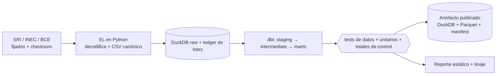

# Ecuador Open-Data Lakehouse

Un lakehouse de ingeniería analítica local-first sobre datos abiertos ecuatorianos
verificados: recaudación de impuestos del SRI, precios al consumidor del INEC y
cuentas nacionales del BCE en DuckDB + dbt, con esquema estrella, dimensión SCD2
de impuestos, hechos incrementales, un producto de datos publicado y verificable
y un reporte offline.

[](https://github.com/Eduardo12Pacheco/lakehouse-datos-abiertos-ecuador/actions/workflows/ci.yml)
[](LICENSE)
[](pyproject.toml)
[](uv.lock)


| Tema claro | Tema oscuro |
| --- | --- |
|  |  |

## Qué hace

- **Adquiere tres fuentes reales** con URLs fijadas, checksums SHA-256, evidencia
  de licencia y una lista blanca de hosts. La muestra incluida hace que el build
  por defecto sea totalmente offline; el modo `full` descarga los archivos
  originales.
- **Resiste archivos públicos desordenados**: CSV del SRI con BOM UTF-8 y cp1252,
  delimitador `|` y decimales con coma; punto y coma y separadores de miles del
  BCE; zips anidados del INEC con meses en español y formatos decimales mixtos.
- **Modela un esquema estrella conformado** en dbt: 7 dimensiones, 3 hechos,
  4 marts analíticos, una dimensión SCD2 determinista de líneas de impuesto y
  cargas incrementales de hechos por partición.
- **Demuestra calidad**: tests de datos y unitarios de dbt, reconciliación contra
  totales de control, property tests con Hypothesis y una compuerta de calidad
  que detiene el pipeline con código de salida 7.
- **Publica un artefacto versionado**: DuckDB + Parquet ZSTD + manifest +
  `SHA256SUMS`, verificado por `lakehouse verify` y protegido por un contrato
  semver.
- **Sirve un reporte estático terminado** en loopback con temas claro/oscuro,
  navegación por teclado, estados vacío/error y ECharts incluido (sin CDN).

## Arquitectura



Los ports y adapters hexagonales mantienen puro el dominio, Python se encarga de
la extracción y dbt de toda la transformación. La dirección de dependencias está
forzada por contratos de import-linter y un test AST. Ver
[docs/ARCHITECTURE.md](docs/ARCHITECTURE.md) para capas, puertos, patrones,
diagrama ER, DAG del pipeline y códigos de salida.

## Inicio rápido

Requiere [uv](https://docs.astral.sh/uv/) (uv instala Python 3.12 si hace falta).
Estos tres comandos son idénticos en bash, zsh y Windows PowerShell:

```bash
uv tool install git+https://github.com/Eduardo12Pacheco/lakehouse-datos-abiertos-ecuador
lakehouse build
lakehouse serve
```

El reporte abre en `http://127.0.0.1:15080` (cambiar con `--port` o
`LAKEHOUSE_SERVE_PORT`). `lakehouse build` usa solo la muestra incluida y no
necesita red, claves ni cuentas.

### Instalar desde el wheel del release

Cada release etiquetado adjunta el wheel y el sdist:

```bash
uv tool install https://github.com/Eduardo12Pacheco/lakehouse-datos-abiertos-ecuador/releases/download/v0.1.1/ecuador_open_data_lakehouse-0.1.1-py3-none-any.whl
```

## Resultados

Un build `sample` limpio sobre los datos incluidos. Regenerar esta tabla y la
instantánea en [`docs/METRICS.json`](docs/METRICS.json) con
`uv run python scripts/gen_metrics.py`; un test falla si los README se desvían.

<!-- metrics:start -->
| Metric | Value |
| --- | ---: |
| dbt models | 22 |
| dbt data tests | 254 |
| dbt unit tests | 11 |
| pytest tests (default suite) | 688 |
| browser e2e tests | 51 |
| bundled sample payload files | 12 |
| bundled sample size (bytes) | 4,150,137 |
| rows in raw | 1,185,307 |
| rows in staging models | 1,185,307 |
| rows in intermediate models | 4,726 |
| rows in marts | 1,184,086 |
| tables in the published artifact | 14 |
<!-- metrics:end -->

El artefacto publicado conserva solo `marts` y `meta.build_info`: 7 dimensiones,
3 hechos y 4 marts analíticos. Dos builds limpios producen `content_sha256`
idénticos para todas las tablas.

## Datos y licencia

| Fuente | Cobertura | Licencia |
| --- | --- | --- |
| Recaudación de impuestos del SRI | 2017–2026, grano provincial en la muestra | CC BY |
| Índice de precios al consumidor del INEC | ene-2015–dic-2024, base 2014 = 100 | CC BY 4.0 |
| Cuentas nacionales del BCE | 2000Q1–2021Q1, 45 industrias + agregados del PIB | CC BY |

El código es MIT. Los datos conservan la licencia de su fuente y solo se
redistribuyen cuando la licencia lo permite; [`ATTRIBUTION.md`](src/ecuador_lakehouse/sample_data/ATTRIBUTION.md)
registra URLs, checksums y modificaciones. La procedencia completa y los hechos
medidos están en [docs/DATA.md](docs/DATA.md).

## Limitaciones

- La recaudación del SRI cubre **solo impuestos administrados por el SRI**; no es
  presión fiscal total ni todo el presupuesto público.
- La versión del IPC termina en **dic-2024** (base 2014 = 100); el rebase de 2026
  queda fuera de alcance.
- Las cuentas nacionales del BCE terminan en **2021Q1**, así que la relación
  SRI/PIB solo es completa para 2017–2020 y los años parciales se marcan con
  `is_complete = false`.
- La muestra incluida es de **grano provincial**; el modo `full` conserva
  cantones. El ciclo de vida SCD2 es real, pero no hay reclasificación de
  grupo/subgrupo en 2017–2026.
- El archivo del SRI del año en curso es mutable en la fuente; su checksum se
  acepta como nueva versión solo con un flag explícito.

## Documentación

- [Arquitectura](docs/ARCHITECTURE.md) · [Datos](docs/DATA.md) · [Artefacto](docs/ARTIFACT.md)
- [Contrato](docs/CONTRACT.md) · [Configuración](docs/CONFIGURATION.md) · [Linaje](docs/LINEAGE.md)
- [ADRs](docs/adr/) · [Contribuir](CONTRIBUTING.md) · [Seguridad](SECURITY.md) · [Changelog](CHANGELOG.md)

## Desarrollo

```bash
uv sync --locked
uv run python scripts/dev.py check
uv run pytest -m e2e
```

`scripts/dev.py check` ejecuta ruff lint/format, mypy strict, import-linter y la
suite de pytest con la compuerta de 85 % de cobertura de ramas. Los tests de
navegador viven detrás de `-m e2e`; `lakehouse doctor` revisa versiones, el
directorio home y la integridad de la muestra incluida.
