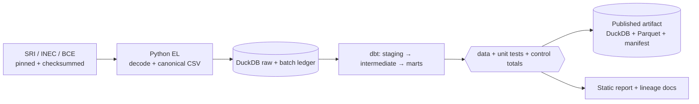

# Ecuador Open-Data Lakehouse

A local-first analytics-engineering lakehouse over verified Ecuadorian open data:
SRI tax collection, INEC consumer prices and BCE national accounts in DuckDB + dbt,
with a star schema, SCD2 tax dimension, incremental facts, a published verifiable
data product and an offline report.

[](https://github.com/Eduardo12Pacheco/lakehouse-datos-abiertos-ecuador/actions/workflows/ci.yml)
[](LICENSE)
[](pyproject.toml)
[](uv.lock)


| Light theme | Dark theme |
| --- | --- |
|  |  |

## What it does

- **Acquires three real sources** with pinned URLs, SHA-256 checksums, license
  evidence and a host allow-list. The bundled sample makes the default build
  fully offline; `full` mode downloads the upstream files.
- **Survives messy public files**: UTF-8 BOM and cp1252 SRI CSVs, `|` delimiters
  and comma decimals, BCE semicolons and thousands separators, nested INEC zips
  with Spanish month headers and mixed decimal formats.
- **Models a conformed star schema** in dbt: 7 dimensions, 3 facts, 4 analytic
  marts, a deterministic SCD2 tax-line dimension and partition-level incremental
  fact loads.
- **Proves quality**: dbt data and unit tests, reconciliation to control totals,
  Hypothesis property tests, a quality gate that stops the pipeline at exit 7.
- **Publishes a versioned artifact**: DuckDB + ZSTD Parquet + manifest +
  `SHA256SUMS`, verified by `lakehouse verify` and guarded by a semver contract.
- **Serves a finished static report** on loopback with light/dark themes,
  keyboard navigation, empty/error states and vendored ECharts (no CDN).

## Architecture



Hexagonal ports and adapters keep the domain pure, Python owns extraction and
dbt owns every transformation. The dependency direction is enforced by
import-linter contracts and an AST test. See
[docs/ARCHITECTURE.md](docs/ARCHITECTURE.md) for the layers, ports, patterns,
ER diagram, pipeline DAG and exit codes.

## Quickstart

Requires [uv](https://docs.astral.sh/uv/) (Python 3.12 is installed by uv if
needed). These three commands are identical in bash, zsh and Windows PowerShell:

```bash
uv tool install git+https://github.com/Eduardo12Pacheco/lakehouse-datos-abiertos-ecuador
lakehouse build
lakehouse serve
```

The report opens at `http://127.0.0.1:15080` (override with `--port` or
`LAKEHOUSE_SERVE_PORT`). `lakehouse build` uses only the bundled sample and needs
no network, keys or accounts.

### Install from a release wheel

Every tagged release attaches the wheel and sdist:

```bash
uv tool install https://github.com/Eduardo12Pacheco/lakehouse-datos-abiertos-ecuador/releases/download/v0.1.1/ecuador_open_data_lakehouse-0.1.1-py3-none-any.whl
```

## Results

A fresh `sample` build on the bundled data. Regenerate this table and the
snapshot in [`docs/METRICS.json`](docs/METRICS.json) with
`uv run python scripts/gen_metrics.py`; a test fails if the READMEs drift.

<!-- metrics:start -->
| Metric | Value |
| --- | ---: |
| dbt models | 22 |
| dbt data tests | 254 |
| dbt unit tests | 11 |
| pytest tests (default suite) | 688 |
| browser e2e tests | 51 |
| bundled sample payload files | 12 |
| bundled sample size (bytes) | 4,150,137 |
| rows in raw | 1,185,307 |
| rows in staging models | 1,185,307 |
| rows in intermediate models | 4,726 |
| rows in marts | 1,184,086 |
| tables in the published artifact | 14 |
<!-- metrics:end -->

The published artifact keeps only `marts` and `meta.build_info`: 7 dimensions,
3 facts and 4 analytic marts. Two fresh builds produce identical
`content_sha256` values for every table.

## Data and license

| Source | Coverage | License |
| --- | --- | --- |
| SRI tax collection | 2017–2026, province grain in the sample | CC BY |
| INEC consumer price index | Jan-2015–Dec-2024, base 2014 = 100 | CC BY 4.0 |
| BCE national accounts | 2000Q1–2021Q1, 45 industries + GDP aggregates | CC BY |

Code is MIT licensed. Data keeps its source license and is redistributed only
where the license allows it; [`ATTRIBUTION.md`](src/ecuador_lakehouse/sample_data/ATTRIBUTION.md)
records URLs, checksums and modifications. Full provenance and measured facts
are in [docs/DATA.md](docs/DATA.md).

## Limitations

- SRI collection covers **SRI-administered taxes only**; it is not total fiscal
  pressure or the whole public budget.
- The CPI vintage stops at **Dec-2024** (base 2014 = 100); the 2026 rebase is out
  of scope.
- BCE national accounts stop at **2021Q1**, so the SRI/GDP ratio is only complete
  for 2017–2020 and partial later years are flagged `is_complete = false`.
- The bundled sample is **province grain**; `full` mode keeps cantons. The SCD2
  lifecycle is real, but no group/subgroup reclassification occurs in 2017–2026.
- The SRI current-year file is mutable upstream; its checksum is accepted as a
  new vintage only with an explicit flag.

## Documentation

- [Architecture](docs/ARCHITECTURE.md) · [Data](docs/DATA.md) · [Artifact](docs/ARTIFACT.md)
- [Contract](docs/CONTRACT.md) · [Configuration](docs/CONFIGURATION.md) · [Lineage](docs/LINEAGE.md)
- [ADRs](docs/adr/) · [Contributing](CONTRIBUTING.md) · [Security](SECURITY.md) · [Changelog](CHANGELOG.md)

## Development

```bash
uv sync --locked
uv run python scripts/dev.py check
uv run pytest -m e2e
```

`scripts/dev.py check` runs ruff lint/format, mypy strict, import-linter and the
pytest suite with the 85 % branch-coverage gate. Browser tests live behind
`-m e2e`; `lakehouse doctor` checks versions, the home directory and the bundled
sample integrity.
