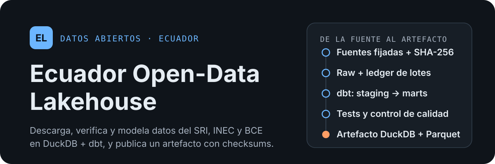
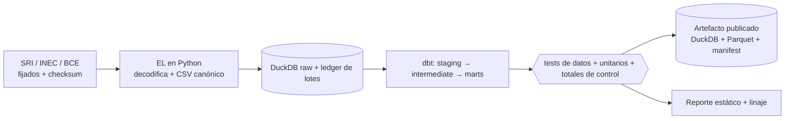

<p align="center"></p>

<p align="center"><b>Español</b> · <a href="README.en.md">English</a></p>

Descarga datos abiertos de Ecuador del SRI, INEC y BCE, verifica sus checksums, los modela con dbt y publica un artefacto versionado, todo en la máquina local.

[](https://github.com/Eduardo12Pacheco/lakehouse-datos-abiertos-ecuador/actions/workflows/ci.yml) [](https://github.com/Eduardo12Pacheco/lakehouse-datos-abiertos-ecuador/releases/latest) [](LICENSE) [](pyproject.toml)


| Tema claro | Tema oscuro |
| --- | --- |
|  |  |

## Qué es

Un lakehouse de ingeniería analítica *local-first* sobre datos abiertos ecuatorianos verificados: recaudación de impuestos del SRI, precios al consumidor del INEC y cuentas nacionales del BCE. Modela un esquema estrella en DuckDB con dbt y sirve un reporte estático sin conexión.

## Por qué es distinto

- **Fuentes fijadas y verificables.** Cada archivo tiene URL fijada, checksum SHA-256, evidencia de licencia y una lista blanca de hosts. El build por defecto usa la muestra incluida y no necesita red.
- **Tolera archivos públicos desordenados.** CSV del SRI con BOM UTF-8 y cp1252, delimitador `|` y decimales con coma; punto y coma y separadores de miles del BCE; zips anidados del INEC con meses en español.
- **Esquema estrella conformado en dbt.** 7 dimensiones, 3 hechos y 4 marts analíticos, una dimensión SCD2 determinista de líneas de impuesto y cargas incrementales por partición.
- **Calidad como compuerta.** Tests de datos y unitarios de dbt, reconciliación contra totales de control y property tests con Hypothesis. Si un test falla, el pipeline se detiene con código de salida 7.
- **Artefacto versionado y verificable.** DuckDB + Parquet ZSTD + manifest + `SHA256SUMS`, comprobado con `lakehouse verify` y protegido por un contrato semver.
- **Reporte estático local.** Se sirve en loopback con temas claro y oscuro, navegación por teclado, estados vacío y error, y ECharts incluido (sin CDN).

## Cómo funciona



Los puertos y adaptadores hexagonales mantienen puro el dominio: Python se encarga de la extracción y dbt de toda la transformación. Import-linter y un test AST fuerzan la dirección de las dependencias. Capas, puertos, patrones, diagrama ER, DAG y códigos de salida están en [docs/ARCHITECTURE.md](docs/ARCHITECTURE.md).

## Inicio rápido

Requiere [uv](https://docs.astral.sh/uv/), que instala Python 3.12 si hace falta. Estos comandos son iguales en bash, zsh y Windows PowerShell:

```bash
uv tool install git+https://github.com/Eduardo12Pacheco/lakehouse-datos-abiertos-ecuador
lakehouse build
lakehouse serve
```

El reporte abre en `http://127.0.0.1:15080` (cambia con `--port` o `LAKEHOUSE_SERVE_PORT`). `lakehouse build` usa solo la muestra incluida: no necesita red, claves ni cuentas. La CI instala el wheel y ejecuta `lakehouse doctor` y `lakehouse build` sin red en Ubuntu, Windows y macOS.

<details>
<summary>Instalar desde el wheel del release</summary>

Cada release etiquetado adjunta el wheel y el sdist:

```bash
uv tool install https://github.com/Eduardo12Pacheco/lakehouse-datos-abiertos-ecuador/releases/download/v0.1.1/ecuador_open_data_lakehouse-0.1.1-py3-none-any.whl
```

</details>

## Resultados

Build `sample` limpio sobre los datos incluidos. Regenera esta tabla y la instantánea en [`docs/METRICS.json`](docs/METRICS.json) con `uv run python scripts/gen_metrics.py`; un test falla si los README se desvían.

<!-- metrics:start -->
| Metric | Value |
| --- | ---: |
| dbt models | 22 |
| dbt data tests | 254 |
| dbt unit tests | 11 |
| pytest tests (default suite) | 688 |
| browser e2e tests | 51 |
| bundled sample payload files | 12 |
| bundled sample size (bytes) | 4,150,137 |
| rows in raw | 1,185,307 |
| rows in staging models | 1,185,307 |
| rows in intermediate models | 4,726 |
| rows in marts | 1,184,086 |
| tables in the published artifact | 14 |
<!-- metrics:end -->

El artefacto publicado conserva solo `marts` y `meta.build_info`: 7 dimensiones, 3 hechos y 4 marts analíticos. Dos builds limpios producen `content_sha256` idénticos para todas las tablas.

## Limitaciones

**Estado:** portafolio en desarrollo activo. Paquete `0.1.1`; el contrato del artefacto está en `1.0.0` y sigue semver ([contrato](docs/CONTRACT.md)).

- La recaudación del SRI cubre **solo impuestos administrados por el SRI**; no es presión fiscal total ni todo el presupuesto público.
- La versión del IPC termina en **dic-2024** (base 2014 = 100); el rebase de 2026 queda fuera de alcance.
- Las cuentas nacionales del BCE terminan en **2021Q1**, así que la relación SRI/PIB solo es completa para 2017–2020 y los años parciales se marcan con `is_complete = false`.
- La muestra incluida es de **grano provincial**; el modo `full` conserva cantones. El ciclo de vida SCD2 es real, pero no hay reclasificación de grupo o subgrupo en 2017–2026.
- El archivo del SRI del año en curso es mutable en la fuente; su checksum se acepta como nueva versión solo con un flag explícito.

## Documentación

- [Arquitectura](docs/ARCHITECTURE.md) · [Datos](docs/DATA.md) · [Artefacto](docs/ARTIFACT.md)
- [Contrato](docs/CONTRACT.md) · [Configuración](docs/CONFIGURATION.md) · [Linaje](docs/LINEAGE.md)
- [ADRs](docs/adr/) · [Contribuir](CONTRIBUTING.md) · [Seguridad](SECURITY.md) · [Changelog](CHANGELOG.md)

<details>
<summary>Desarrollo</summary>

```bash
uv sync --locked
uv run python scripts/dev.py check
uv run pytest -m e2e
```

`scripts/dev.py check` ejecuta ruff lint/format, mypy strict, import-linter y la suite de pytest con la compuerta de 85 % de cobertura de ramas. Los tests de navegador viven detrás de `-m e2e`; `lakehouse doctor` revisa versiones, el directorio home y la integridad de la muestra incluida.

</details>

## Licencia

El código es MIT. Los datos conservan la licencia de su fuente y solo se redistribuyen cuando la licencia lo permite. [`ATTRIBUTION.md`](src/ecuador_lakehouse/sample_data/ATTRIBUTION.md) registra URLs, checksums y modificaciones; la procedencia completa está en [docs/DATA.md](docs/DATA.md).

| Fuente | Cobertura | Licencia |
| --- | --- | --- |
| Recaudación de impuestos del SRI | 2017–2026, grano provincial en la muestra | CC BY |
| Índice de precios al consumidor del INEC | ene-2015–dic-2024, base 2014 = 100 | CC BY 4.0 |
| Cuentas nacionales del BCE | 2000Q1–2021Q1, 45 industrias + agregados del PIB | CC BY |

## Autor

Eduardo Pacheco · https://github.com/Eduardo12Pacheco
