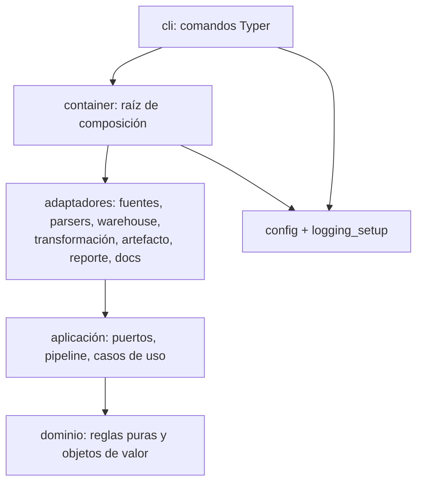
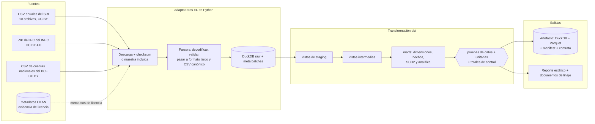
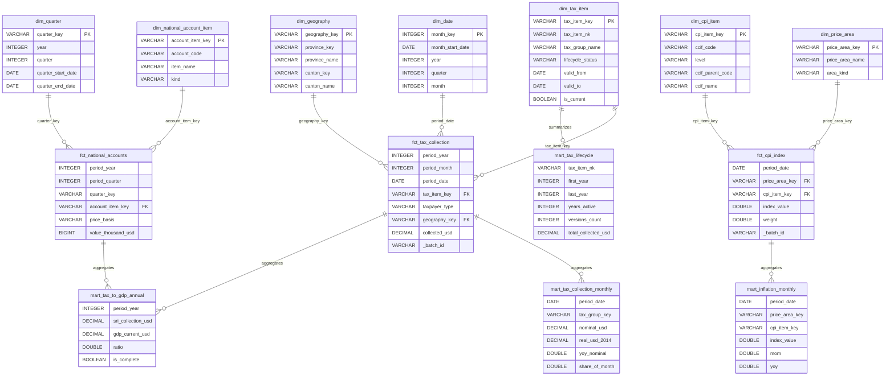
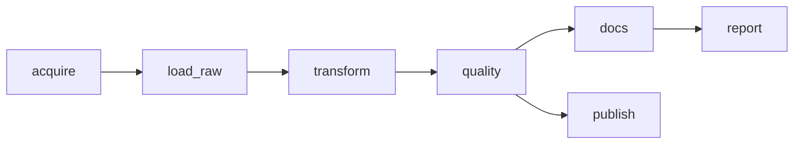

# Arquitectura

El Ecuador Open-Data Lakehouse es un sistema de ingeniería analítica local-first: un
único paquete de Python instala la CLI `lakehouse`, un archivo DuckDB contiene todas las
capas y dbt es responsable de la capa de transformación. No hay servidor, cuenta en la
nube ni acceso obligatorio a la red: el modo `sample` por defecto lee los datos incluidos
en el wheel, mientras que el modo `full` descarga los archivos fijados de las fuentes
originales.

El diseño es hexagonal (puertos y adaptadores). El dominio puro es barato de probar, la
capa de aplicación orquesta los casos de uso a través de protocolos, los adaptadores se
encargan de la E/S y una única raíz de composición conecta todo. Dos mecanismos
independientes hacen cumplir la dirección de las dependencias: los contratos de
import-linter y una prueba AST que revisa cada import bajo `domain/`.

## Capas

La regla de dependencias es:

Las capas superiores pueden importar capas inferiores, nunca al revés. `domain/` solo
importa la biblioteca estándar de Python y `ecuador_lakehouse.domain`. `application/`
conoce los puertos y los objetos de valor del dominio, puede usar la biblioteca estándar
para orquestar archivos y no puede importar `adapters/`, `config`, `logging_setup`,
`duckdb`, `dbt`, `httpx`, `jinja2`, `typer` ni `rich`. Los subpaquetes de adaptadores son
mutuamente independientes: un parser no puede importar el warehouse y el warehouse no
puede importar el renderizador de reportes.

| Paquete | Responsabilidad | Ejemplos |
| --- | --- | --- |
| `domain/` | Reglas puras, claves canónicas de texto, validación del DAG, objetos de valor de lotes y manifiestos, taxonomía de errores | `domain/text.py`, `domain/dag.py`, `domain/manifest.py` |
| `application/` | Casos de uso y puertos; orquestación del pipeline; sin E/S concreta | `application/ports.py`, `application/pipeline.py`, `application/use_cases/` |
| `adapters/` | E/S concreta detrás de los puertos | Descarga HTTP, parsers, DuckDB, dbt, artefacto, reporte, linaje |
| `cli/` | Comandos Typer, presentadores Rich, guardia de códigos de salida | `cli/app.py`, `cli/commands/` |
| `container.py` | Cableado explícito de dependencias y selección de estrategias | `build_container()` |
| `config.py`, `logging_setup.py` | Configuración transversal y configuración de structlog | `Settings`, `configure_logging()` |

La aplicación de estas reglas está en `pyproject.toml` (`[[tool.importlinter.contracts]]`)
y en `tests/architecture/test_layers.py`. La prueba AST también inserta un archivo que
viola las reglas en un paquete temporal, para que la guardia no deje de funcionar en
silencio.

## Puertos y adaptadores

| Puerto (`application/ports.py`) | Adaptador | Responsabilidad |
| --- | --- | --- |
| `SourceFetcher` | `HttpSourceFetcher`, `SampleSourceFetcher` | Obtener un archivo fijado y verificar su SHA-256; la estrategia se selecciona según el modo |
| `LicenseCatalog` | `CkanCatalog` | Leer los metadatos de licencia de CKAN |
| `SourceParser` | `SriTaxParser`, `BceCntParser`, `InecCpiParser` | Decodificar, validar y emitir CSV canónico en UTF-8 |
| `Warehouse` | `DuckDbWarehouse` | Repositorio de la capa raw, ledger de lotes y carga de partición en una sola transacción |
| `RunLedger` | `DuckDbWarehouse` | Persistir los registros de ejecución del pipeline en `meta.runs` |
| `Transformer` | `DbtTransformer` | Ejecutar seed, run y test de los modelos dbt en el mismo proceso; parse y docs |
| `LineageRenderer` | `LineageMermaidRenderer` | Renderizar el DAG de dbt como Markdown/Mermaid |
| `ReportReader` | `DuckDbReportReader` | Leer los marts en un `ReportSnapshot` tipado |
| `ReportRenderer` | `JinjaReportRenderer` | Escribir el sitio estático de varias páginas |
| `ArtifactStore`, `ArtifactVerifier` | `DuckDbArtifactPublisher`, `DuckDbArtifactVerifier` | Publicar y volver a verificar el producto de datos versionado |

La CLI y la raíz de composición son los únicos lugares que conocen los adaptadores
concretos. Cambiar HTTP por la muestra incluida modifica una sola rama de fábrica en
`container.py`, no los casos de uso.

## Patrones utilizados

Los siguientes patrones son deliberados, no decorativos:

- **Ports & Adapters** — cada dependencia externa tiene un puerto `typing.Protocol`;
  los adaptadores lo implementan y los elige la raíz de composición.
- **Strategy** — `SourceFetcher` (HTTP frente a muestra incluida), `SourceParser`
  (SRI, BCE, INEC), la decodificación (UTF-8-sig y luego cp1252) y el registro de pasos
  del pipeline.
- **Factory / Composition root** — `container.build_container()` construye el grafo de
  objetos, selecciona el fetcher específico del modo y arma los pasos del DAG.
- **Repository** — `meta.batches` es el ledger de lotes de solo adición detrás de
  `Warehouse.ledger()`, y `meta.runs` es el ledger de ejecuciones del pipeline.
- **Unit of Work** — la carga de una partición es una sola transacción de DuckDB: las
  filas previas de la partición, la actualización del ledger y las filas nuevas se
  confirman juntas o se revierten juntas.
- **Pipeline / DAG con Template Method** — `domain.dag.Dag` valida y ordena los pasos;
  `application.pipeline.PipelineRunner` aporta la selección, los reintentos, la detención
  ante fallos y el registro de ejecuciones, mientras que cada paso aporta solo su trabajo
  mediante una forma común de invocación.
- **Value Objects** — dataclasses inmutables como `SourceFile`, `BatchRecord`,
  `QualitySummary`, `RunRecord` y `ArtifactManifest` validan su contenido al construirse.
- **Pruebas genéricas al estilo Specification** — `assert_between`,
  `assert_unique_combination`, `assert_scd2_integrity`, `assert_row_count_at_least` y
  `assert_no_month_gaps` codifican invariantes de datos reutilizados entre modelos.

## Flujo de datos de extremo a extremo

Los parsers conservan cada valor de origen como texto crudo en el CSV canónico. dbt es el
único lugar donde ocurren el tipado, el parseo de decimales, el parseo de meses, la
normalización de claves, las claves sustitutas y los modelos de negocio. Este límite está
registrado en [ADR 0003](adr/0003-el-in-python-t-in-dbt.md).

La capa raw conserva una tabla por fuente, con todas las columnas de origen como
`VARCHAR`, además de `_batch_id`, `_source_file` y `_source_sha256`. El ledger de lotes
registra la partición, el checksum de la fuente, el número de filas, el estado y si la
fila es la vigente; así, volver a cargar una partición idéntica no hace nada, y una
partición modificada se reemplaza dentro de una sola transacción.

## Capas de dbt

El proyecto dbt viene dentro del wheel y se copia al directorio home de ejecución antes de
cada ejecución ([ADR 0001](adr/0001-stack-duckdb-dbt.md)). Los nombres siguen el patrón
`stg_<fuente>__<entidad>`, `int_*`, `dim_*`, `fct_*`, `mart_*`.

| Capa | Materialización | Modelos |
| --- | --- | --- |
| `staging` | view | `stg_sri__tax_collection`, `stg_bce__national_accounts`, `stg_inec__cpi_index` |
| `intermediate` | view | `int_tax_item_year_presence`, `int_tax_item_versions`, `int_tax_collection_monthly`, `int_cpi_national_monthly`, `int_gdp_annual` |
| `marts` | table / incremental | 7 dimensiones, 3 hechos y 4 marts analíticos |

Cada modelo y cada columna tienen una descripción no vacía; cada mart tiene un contrato
aplicado. El [documento de linaje](LINEAGE.md) versionado se genera a partir de un
`dbt parse` nuevo, y una prueba falla si se desvía.

## Modelo de datos

El esquema estrella tiene siete dimensiones conformadas, tres hechos y cuatro marts
analíticos. Las claves sustitutas son hashes `md5` de las partes de la clave natural,
nunca `row_number()`, de modo que dos builds coinciden.

| Tabla | Grano | Tipo |
| --- | --- | --- |
| `dim_date` | mes | dimensión |
| `dim_quarter` | trimestre | dimensión |
| `dim_geography` | provincia x cantón | dimensión |
| `dim_tax_item` | clave natural del impuesto x versión SCD2 | dimensión (SCD2) |
| `dim_price_area` | área de precios del INEC | dimensión |
| `dim_cpi_item` | ítem CCIF | dimensión |
| `dim_national_account_item` | ítem de cuenta del BCE | dimensión |
| `fct_tax_collection` | mes x versión del impuesto x tipo de contribuyente x geografía | hecho incremental |
| `fct_cpi_index` | mes x área de precios x ítem del IPC | hecho |
| `fct_national_accounts` | trimestre x ítem de cuenta x base de precios | hecho |
| `mart_tax_collection_monthly` | mes x grupo de impuestos | mart analítico |
| `mart_inflation_monthly` | mes x área de precios x nivel del ítem del IPC | mart analítico |
| `mart_tax_to_gdp_annual` | año | mart analítico |
| `mart_tax_lifecycle` | clave natural del impuesto | mart analítico |

`dim_tax_item` es un modelo SQL determinista de SCD2, no un snapshot de dbt: las islas de
versiones se derivan de la matriz de presencia, la vigencia proviene de los datos y no del
reloj, y los hechos se unen con la versión vigente en su año de recaudación
([ADR 0005](adr/0005-scd2-lifecycle-dimension.md)). `fct_tax_collection` es incremental con
`delete+insert` sobre `period_year`, de modo que cargar un año vigente modificado reescribe
solo esa partición, mientras que las particiones anteriores conservan su `_batch_id`.

## DAG del pipeline

`lakehouse build` ejecuta la selección por defecto `acquire, load_raw, transform, quality,
docs, report`; agregar `--publish` añade `publish`. El runner admite `--select STEP` (el
paso más sus dependencias previas), `--only STEP` (exactamente un paso) y `--from-step STEP`
(el paso y todos los siguientes), y rechaza las combinaciones mutuamente excluyentes con
código de salida 2. Solo se reintenta `acquire`, porque es idempotente; cada ejecución,
incluida una fallida, se escribe en `meta.runs` con el estado por paso, los intentos, la
duración y las métricas.

El runner propio es una decisión de alcance deliberada: Dagster y Airflow añadirían un
servicio y una base de metadatos a una CLI de un solo proceso de nivel L1
([ADR 0006](adr/0006-custom-dag-runner-vs-dagster.md)).

## Modelo de fallos y códigos de salida

Cada fallo esperado es una subclase de `LakehouseError` que declara su código de salida. La
guardia de la CLI lo convierte en un mensaje limpio (sin traceback salvo con `--debug`). Las
excepciones inesperadas terminan con código 1.

| Código de salida | Error | Significado |
| --- | --- | --- |
| 0 | — | éxito |
| 1 | inesperado | excepción no controlada (traceback solo con `--debug`) |
| 2 | `ConfigError` | configuración inválida o uso incorrecto del comando |
| 3 | `ChecksumMismatchError` | una descarga inmutable fijada no coincidió con su SHA-256 |
| 4 | `SourceSchemaError` / `UnsafeArchiveError` | cambio de encabezados en la fuente o archivo inseguro |
| 5 | `SourceUnavailableError` | una fuente no puede alcanzarse ni leerse |
| 6 | `TransformError` | fallo de seed/run/parse/docs de dbt |
| 7 | `QualityGateError` | al menos una prueba de datos o unitaria de dbt falló |
| 8 | `ArtifactVerificationError` | artefacto ausente, corrupto o con cambio de esquema |

El pipeline se detiene en el primer paso que falla, así que un fallo de la compuerta de
calidad nunca llega a `docs`, `report` ni `publish`.

## Idempotencia, cargas incrementales y determinismo

- **La adquisición** es idempotente: un archivo en caché cuyo SHA-256 coincide con el
  checksum fijado se reutiliza. Los archivos mutables (el año SRI en curso) registran una
  versión aceptada solo con `--accept-new-vintage`; las discrepancias en archivos
  inmutables fallan con código de salida 3.
- **La carga raw** es una Unit of Work: el warehouse compara el checksum vigente del ledger
  para una partición, omite los bytes idénticos o elimina y recarga la partición en una sola
  transacción. Un fallo revierte tanto los datos como el ledger.
- **Los hechos incrementales** usan `delete+insert` sobre `period_year` con
  `on_schema_change: fail`, de modo que un cambio de contrato detiene la ejecución en lugar
  de modificar en silencio una tabla publicada.
- **SCD2** se reconstruye desde la matriz de presencia en cada ejecución, así que la capa raw
  sigue siendo la única fuente de verdad y volver a ejecutar un build es seguro.
- **El determinismo** proviene de claves sustitutas basadas solo en datos (`md5` de las
  partes de la clave natural), la ausencia de columnas de reloj en los marts, un orden
  estable y `gzip mtime=0` para la muestra incluida. Dos builds limpios de la muestra
  producen valores `content_sha256` idénticos para las 14 tablas publicadas
  ([ADR 0007](adr/0007-artifact-contract-and-versioning.md)).

## Superficie de la CLI

| Comando | Propósito |
| --- | --- |
| `lakehouse build` | Ejecutar el DAG del pipeline; `--publish --out DIR` además publica el artefacto |
| `lakehouse test` | Ejecutar solo el paso `quality` (pruebas de datos y unitarias de dbt) |
| `lakehouse fetch` | Descargar y verificar los archivos fijados de las fuentes (`--source`, `--years`, `--accept-new-vintage`) |
| `lakehouse sample build` | Comando de mantenimiento que regenera la muestra incluida |
| `lakehouse docs` | Generar la documentación estática de dbt y el linaje en Mermaid (`--mermaid PATH`) |
| `lakehouse publish` | Publicar los marts actuales como artefacto versionado (`--out`) |
| `lakehouse verify DIR` | Volver a verificar un artefacto publicado; código 8 si hay manipulación |
| `lakehouse contract check` | Comparar el contrato versionado con el esquema del warehouse |
| `lakehouse serve` | Servir el reporte generado en loopback (`--host`, `--port`, `--open/--no-open`) |
| `lakehouse doctor` | Revisar versiones, permisos de escritura del home, integridad de la muestra y, opcionalmente, el alcance de la red |
| `lakehouse --version` | Imprimir la versión del paquete |

## Configuración y observabilidad

`config.Settings` es un modelo de `pydantic-settings` con el prefijo `LAKEHOUSE_`. Los
valores inválidos se convierten en `ConfigError` (código 2) antes de iniciar cualquier
trabajo. El logging usa structlog con un renderizador `console` o `json`, seleccionado
mediante `LAKEHOUSE_LOG_FORMAT`. La lista completa de variables, sus valores por defecto y
las sobrescrituras por CLI están en [CONFIGURATION.md](CONFIGURATION.md).

## Pruebas y compuertas de calidad

- `uv run python scripts/dev.py check` ejecuta ruff lint, la verificación de formato de
  ruff, mypy estricto, import-linter y la suite de pytest (sin las pruebas de navegador).
- `uv run pytest -m e2e` ejecuta la suite de Playwright contra un sitio real generado.
- Las pruebas de datos de dbt, las pruebas unitarias de dbt y las pruebas singulares de
  reconciliación se ejecutan dentro de `lakehouse build`/`lakehouse test`; una prueba fallida
  cierra la compuerta con código de salida 7.
- La cobertura se exige al 85 % de cobertura de ramas en `src/`, y una suite de Hypothesis
  cubre el orden del DAG, la normalización de texto, la paridad de codificación de los
  parsers, las permutaciones de carga y la integridad de SCD2.
- La CI ejecuta lint, tipos y arquitectura en Ubuntu, y la suite de pruebas en Ubuntu,
  Windows y macOS, además de un job de navegador, una matriz de smoke de instaladores y
  jobs de seguridad.

El producto de datos publicado y sus reglas de versionado están documentados en
[ARTIFACT.md](ARTIFACT.md) y [CONTRACT.md](CONTRACT.md); la procedencia de las fuentes, los
hechos medidos y las limitaciones están en [DATA.md](DATA.md).
